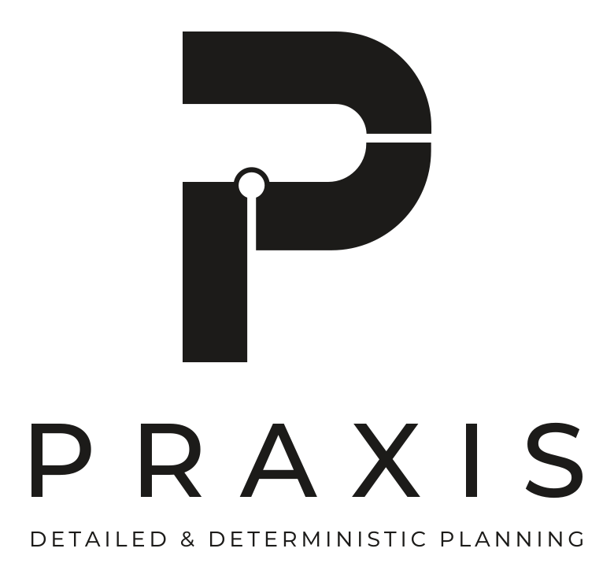

<h1 align="center">
  <picture>
    <source media="(prefers-color-scheme: dark)" srcset="docs/brand/praxis-logo-dark.svg">
    
  </picture>
</h1>

<strong>Plan systems. Ship code.</strong>

  <a href="https://dushyantchetiwal.github.io/praxis/">Product Page</a> &middot;
  <a href="https://github.com/DushyantChetiwal/praxis/releases/latest">Download Desktop 2.0</a> &middot;
  <a href="https://github.com/DushyantChetiwal/praxis/releases?q=praxis-remote-android">Android Remote APK</a> &middot;
  <a href="./docs/src/ai/architect-portfolio.md">Architecture</a>

Praxis is an open-source, plan-driven AI code editor for detailed and
deterministic engineering. It is an independent product built in Rust on the
open-source [Zed](https://github.com/zed-industries/zed) editor and is not
affiliated with or endorsed by Zed Industries.

## Architect View & Unified Planning

Instead of treating an agent as an opaque one-turn chat box, Praxis makes
planning inspectable and executable. Work can be tracked as a live checklist or
opened on the **Architect Canvas** as a graph of explicit steps, constraints,
file surfaces, conditional branches, bounded retry loops, and hand-off
captures. Individual steps can be discussed in their own chats, checkpointed as
they complete, and resumed safely without redoing finished work.

Switch seamlessly between **Code** and **Architect** views; opening any file
from the canvas jumps directly into the editor. Native threads use two clear
modes: **Plan** (read-only research and planning) and **Build** (approved edits,
commands, and live Architect run controls).

### What's in Praxis 2.0

- **Parallel Git worktree agents**: Spawn threads, sub-agents, and concurrent
  plan branches inside isolated Git worktrees with static file-surface conflict
  checks, then review diffs and merge back to your primary checkout.
- **Non-blocking async watchers**: Long-running builds, CI checks, sub-agents,
  and Architect runs execute asynchronously and automatically wake the parent
  conversation when they finish, fail, or need input.
- **Multi-provider & external ACP agents**: Use native Gemini, Claude, OpenAI,
  OpenRouter, or local Ollama models alongside external Agent Client Protocol
  (ACP) agents like Cursor, Claude Code, and Codex—plus remote global skills
  over SSH, WSL, and dev containers.
- **Native Git tools & reliability**: Dedicated read-only `git_*` tools avoid
  interactive pager hangs, and an out-of-process desktop watchdog supports clean
  recovery and remote restarts.

The main Praxis additions live in:

- [`crates/architect`](./crates/architect) — plan DAG compiler, file-surface validator, checkpoints, and runner
- [`crates/agent`](./crates/agent) — native tools, async watchers, Git worktree isolation, and reliability guards
- [`crates/agent_ui`](./crates/agent_ui) — Architect canvas UI, live sub-agent HUD, and Remote Protocol v3 host
- [`remote-android`](./remote-android) — Kotlin + Jetpack Compose companion app for Android

See [`docs/src/ai/architect-portfolio.md`](./docs/src/ai/architect-portfolio.md)
for the architecture and reproducible demo.

## Praxis Remote for Android

Operate desktop windows or headless Linux/WSL hosts directly from your phone:
stream responses, approve tool permissions, answer agent questions, switch
models, inspect Architect plans and Git worktrees, browse remote files, or
steer turns by voice.

- **Zero-server encrypted transport**: Pair once with a six-digit code via
  GitHub sign-in (or directly from the CLI on headless hosts) and communicate
  end-to-end encrypted over WebRTC and Nostr relays—no paid relay servers or
  open inbound ports.
- **0 ms cold start & delta streaming**: Opens immediately from an on-device
  SQLite state cache and receives sub-100 ms Protocol v3 incremental deltas
  with lazy-loaded history.

Download the signed APK from
[Android Remote Releases](https://github.com/DushyantChetiwal/praxis/releases?q=praxis-remote-android).
See [`docs/src/ai/praxis-remote.md`](./docs/src/ai/praxis-remote.md) for setup
and the security model, and
[`docs/src/ai/praxis-remote-protocol.md`](./docs/src/ai/praxis-remote-protocol.md)
for the Protocol v3 specification.

## Installation and updates

Pre-built Windows, macOS, and Linux binaries are published through
[GitHub Releases](https://github.com/DushyantChetiwal/praxis/releases/latest):

- **Windows x86_64**: `Praxis-x86_64.exe`
- **macOS Apple silicon**: `Praxis-aarch64.dmg`
- **macOS Intel**: `Praxis-x86_64.dmg`
- **Linux x86_64**: `praxis-linux-x86_64.tar.gz`
- **Android**: `PraxisRemote-*.apk` ([Android releases](https://github.com/DushyantChetiwal/praxis/releases?q=praxis-remote-android))

> **Note on unsigned desktop builds:** Desktop installers are currently
> unsigned. On Windows SmartScreen, choose **More info → Run anyway**. On
> macOS, if Gatekeeper blocks the first launch, clear the quarantine attribute
> with `xattr -cr /Applications/Praxis.app`.

Windows and Linux builds publish after every merged change. macOS builds refresh
weekly, so the latest release carries the most recent weekly macOS packages.

Installed **Praxis Dev** builds poll the repository's signed-hash update
manifest and update through the in-app updater. Praxis uses its own application,
installer, process, registry, bundle, and user-data identities, so it can remain
installed beside Stable Zed without sharing or modifying Stable Zed data.

## Upstream maintenance

A scheduled GitHub workflow merges `zed-industries/zed` into a staging branch
with deterministic conflict resolution (`script/resolve-upstream-sync.py`),
validates the exact merge with the Praxis quality workflow, and promotes only a
green result so upstream editor improvements, provider updates, and security
fixes continue flowing into Praxis.

## Development

`main` is the product branch. Changes land through pull requests, and every
push and pull request to `main` runs the Architect quality workflow.

Praxis retains Zed's internal crate names and most source identifiers to keep
upstream merges reviewable. Platform builds and Rust validation run in GitHub
Actions rather than on contributor workstations.

The upstream platform build documentation remains applicable:

- [macOS](./docs/src/development/macos.md)
- [Linux](./docs/src/development/linux.md)
- [Windows](./docs/src/development/windows.md)

See [CONTRIBUTING.md](./CONTRIBUTING.md) before submitting changes.

## Licensing and attribution

Praxis is derived from Zed, which is developed by Zed Industries, Inc. Zed and
its associated marks belong to their respective owners. This repository keeps
the upstream copyright, license, and attribution notices.

The source is licensed primarily under GPL-3.0-or-later, with Apache-2.0
components where marked. Third-party dependency notices are generated with
[`cargo-about`](https://github.com/EmbarkStudios/cargo-about).
